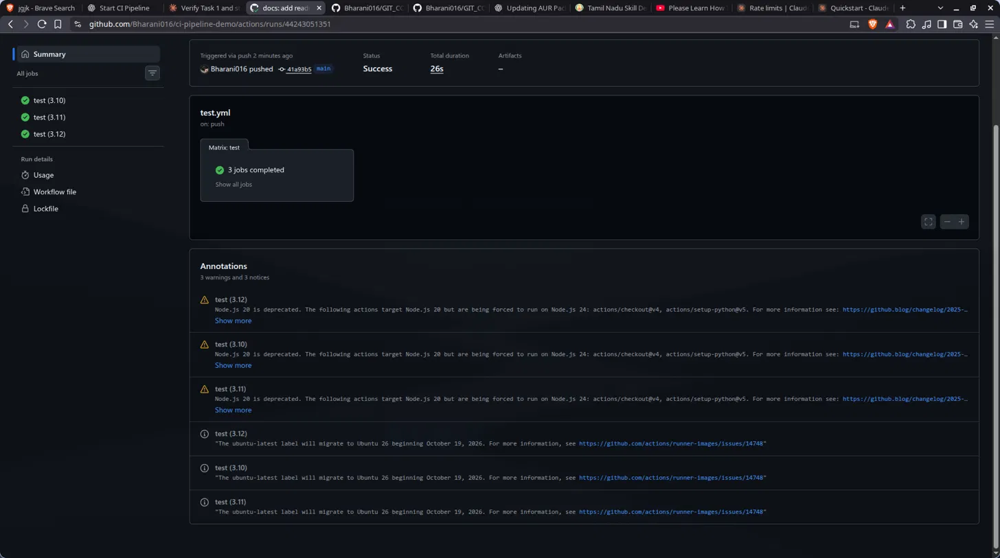
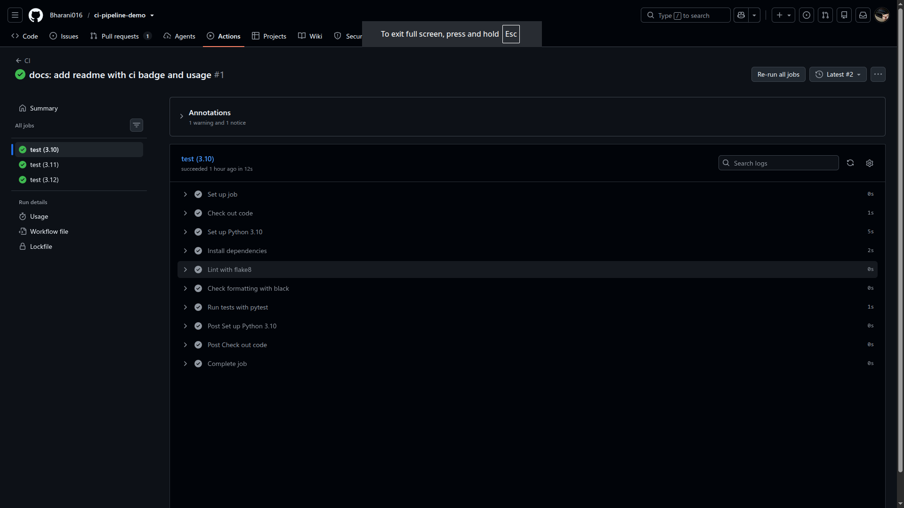
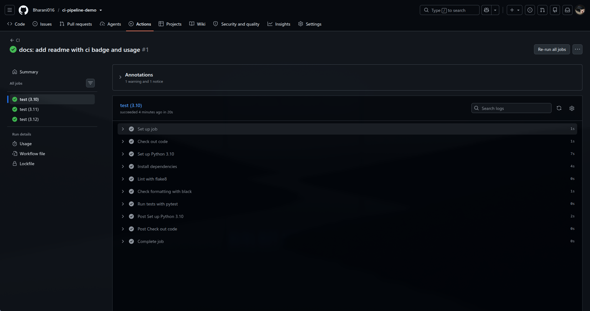
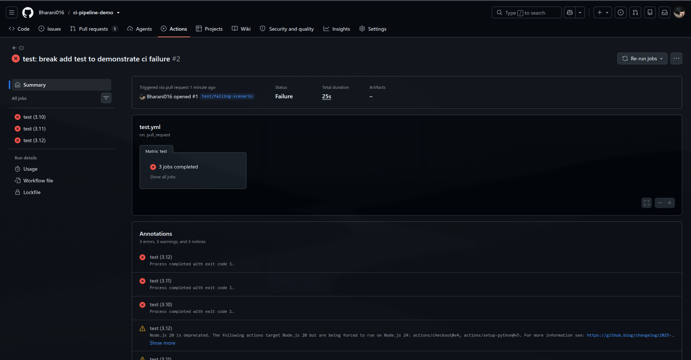
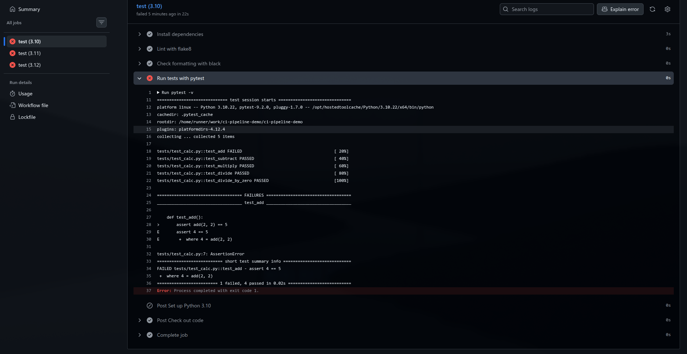
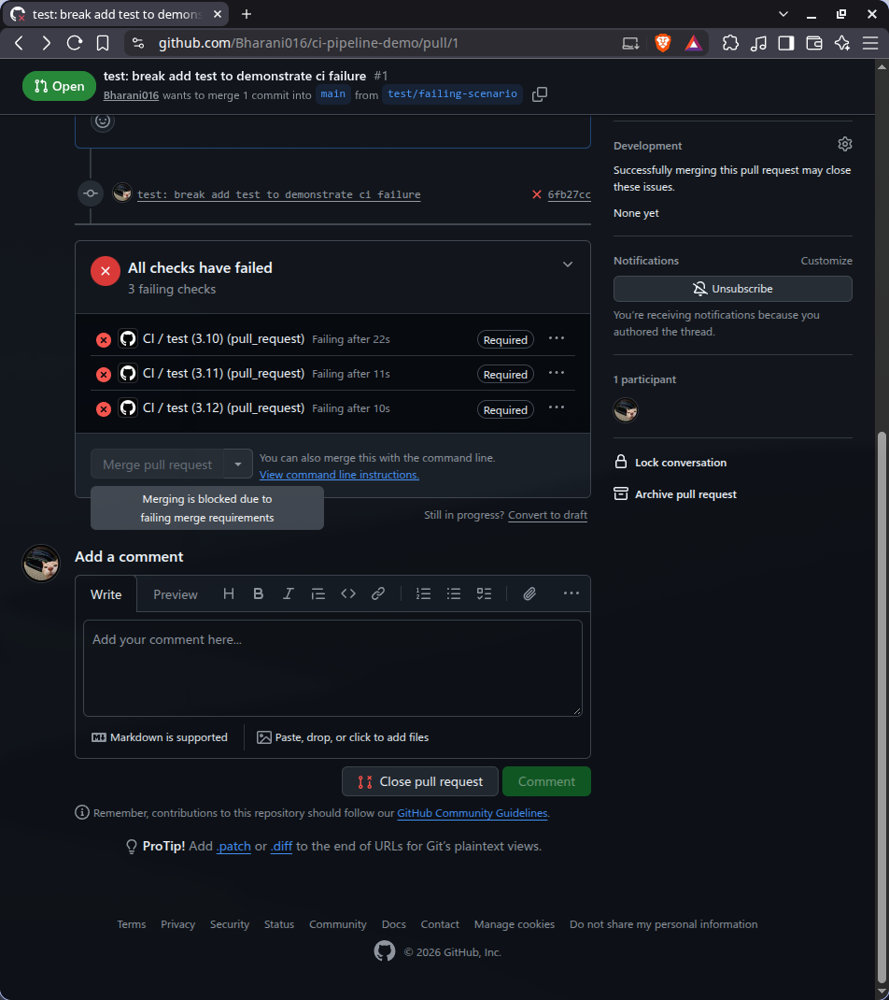
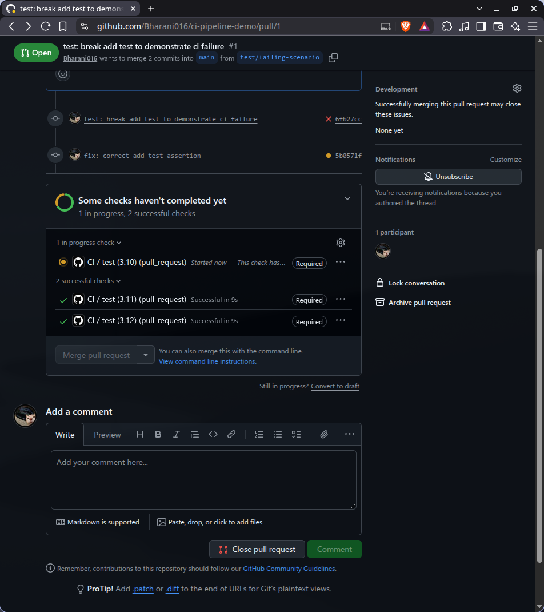
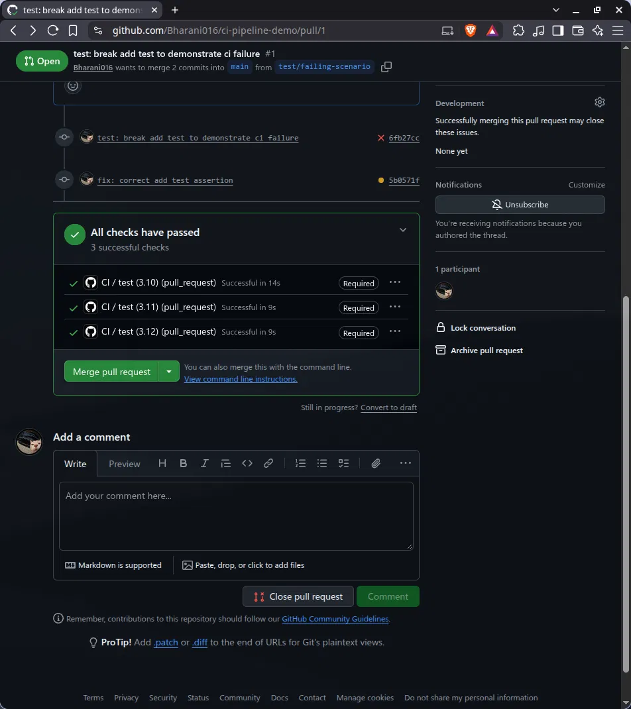

# CI Pipeline Demo


A small Python calculator used to demonstrate an automated multi-version CI pipeline with GitHub Actions.

Every push and pull request to `main` automatically runs linting, a formatting check and the unit tests on Python 3.10, 3.11 and 3.12.

---

## Project Structure

```text
.
├── .github/workflows/test.yml   # CI workflow
├── app/
│   ├── __init__.py
│   └── calc.py                  # calculator functions
├── tests/
│   ├── __init__.py
│   └── test_calc.py             # pytest unit tests
├── assets/images/               # CI screenshots
├── requirements.txt             # pytest, flake8, black
├── LICENSE
└── README.md
```

---

## Run Locally

```bash
python -m venv .venv
source .venv/bin/activate
pip install -r requirements.txt

python -m flake8 app tests
python -m black --check app tests
python -m pytest -v
```

---

## How the Pipeline Works

Workflow file: `.github/workflows/test.yml`

| Feature | Detail |
|---------|--------|
| Triggers | Push and pull request to `main` |
| Matrix | Python 3.10, 3.11, 3.12 |
| Lint | `flake8 app tests` |
| Format check | `black --check app tests` |
| Tests | `pytest -v` |
| Caching | `cache: pip` in `actions/setup-python` |
| Failure behaviour | Any failing step exits non-zero and marks the run red |

If any step fails, the job fails. With branch protection enabled, a pull request with a failing check cannot be merged.

---

## Branch Protection

The `main` branch requires a pull request and the three status checks (`test (3.10)`, `test (3.11)`, `test (3.12)`) to pass before merging.

---

## Failure Scenario

A pull request that deliberately contains a failing test shows the pipeline going red and the merge button being blocked. After the test is fixed, the checks turn green and the pull request can be merged.

---

## Execution Evidence

### Passing run

All three Python versions pass on the first run (26s).



### Passing steps

Lint, format check and tests all pass on Python 3.10.



### Cached dependencies

The re-run finishes in 15s instead of 26s because the pip cache is restored.



### Failing pull request

The pull request `test/failing-scenario` contains a deliberately broken test. All three matrix jobs fail.



### Failing test log

The `Run tests with pytest` step exits with code 1.



### Blocked merge

With branch protection enabled, the merge button is disabled while the checks fail.



### Checks pending

After the fix is pushed, the pipeline runs again. The merge button stays disabled while a required check is still running.



### Fixed pull request

After the test is corrected, all three required checks pass and the merge button is enabled.



---

## Execution Logs

Passing run:

```text
tests/test_calc.py .....                                    [100%]

============================ 5 passed in 0.06s ============================
```

Failing run:

```text
tests/test_calc.py F....                                    [100%]

================================ FAILURES =================================
_______________________________ test_add __________________________________

    def test_add():
>       assert add(2, 2) == 5
E       assert 4 == 5
E        +  where 4 = add(2, 2)

tests/test_calc.py:7: AssertionError
========================= short test summary info =========================
FAILED tests/test_calc.py::test_add - assert 4 == 5
======================== 1 failed, 4 passed in 0.16s ======================
```

In GitHub Actions the same failure ends with `Process completed with exit code 1`, which marks the job red.

---

## Commit Convention

Commits follow Conventional Commits: `feat`, `fix`, `test`, `chore`, `ci`, `docs`.

---

## License

MIT License. See `LICENSE`.
